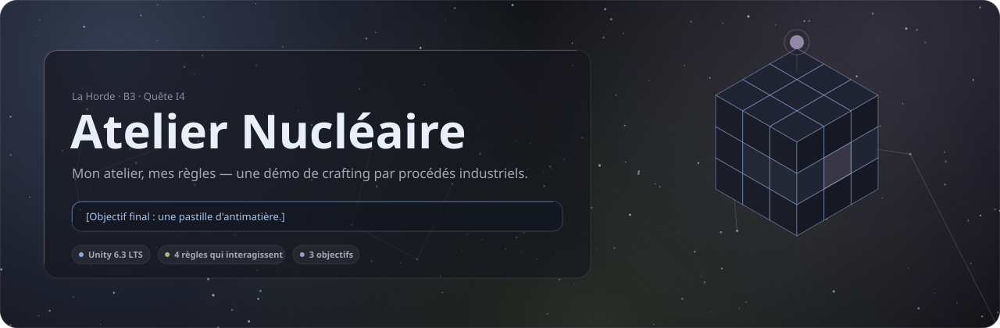
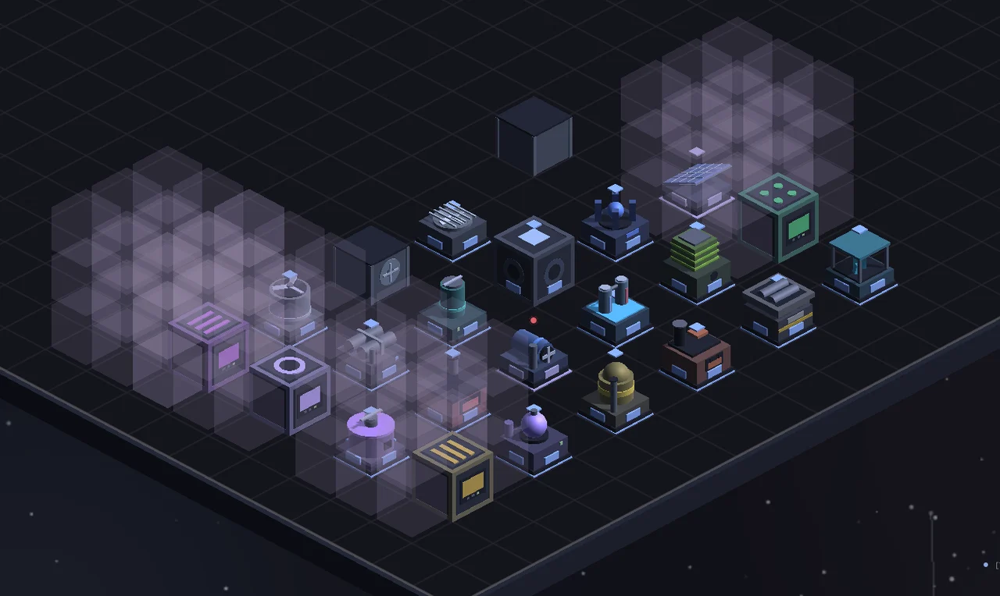
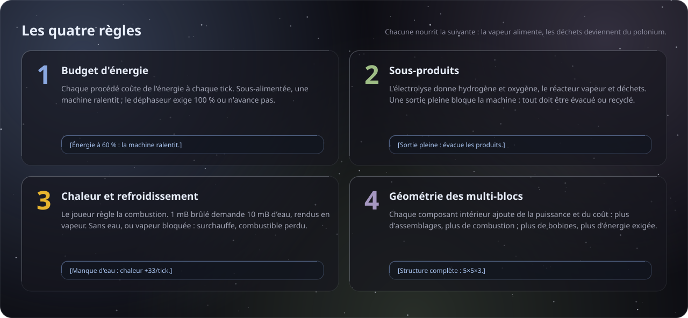
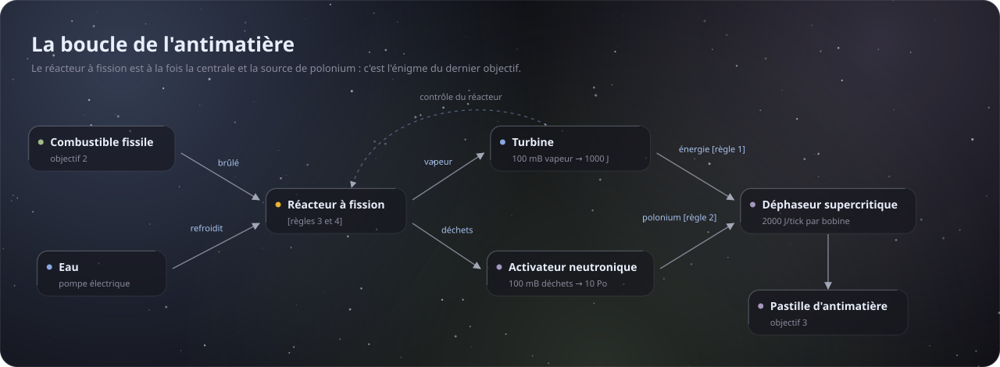
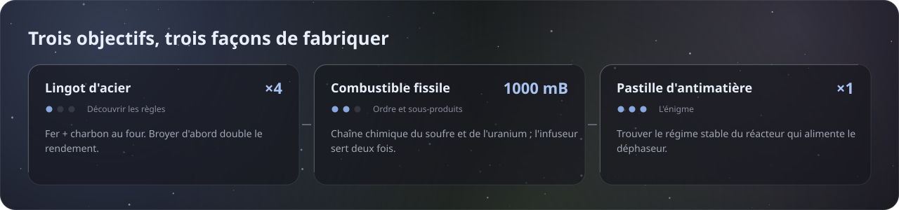
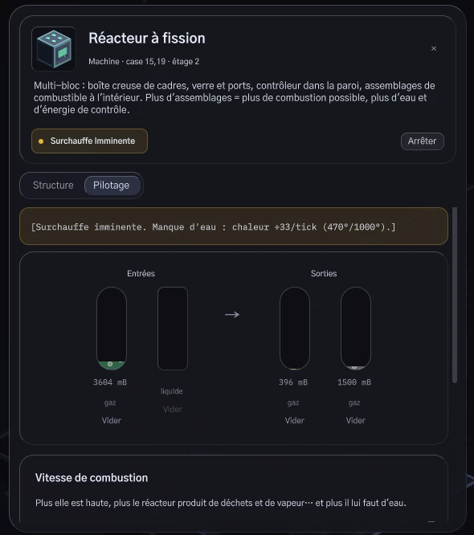
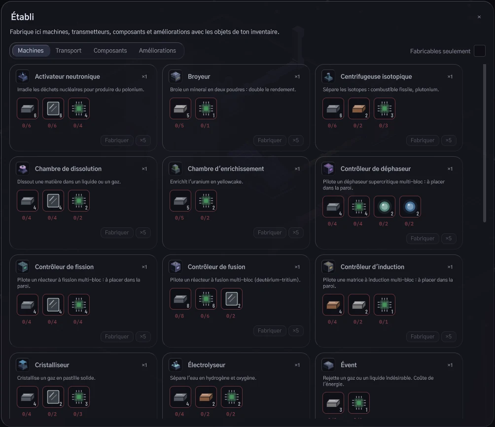
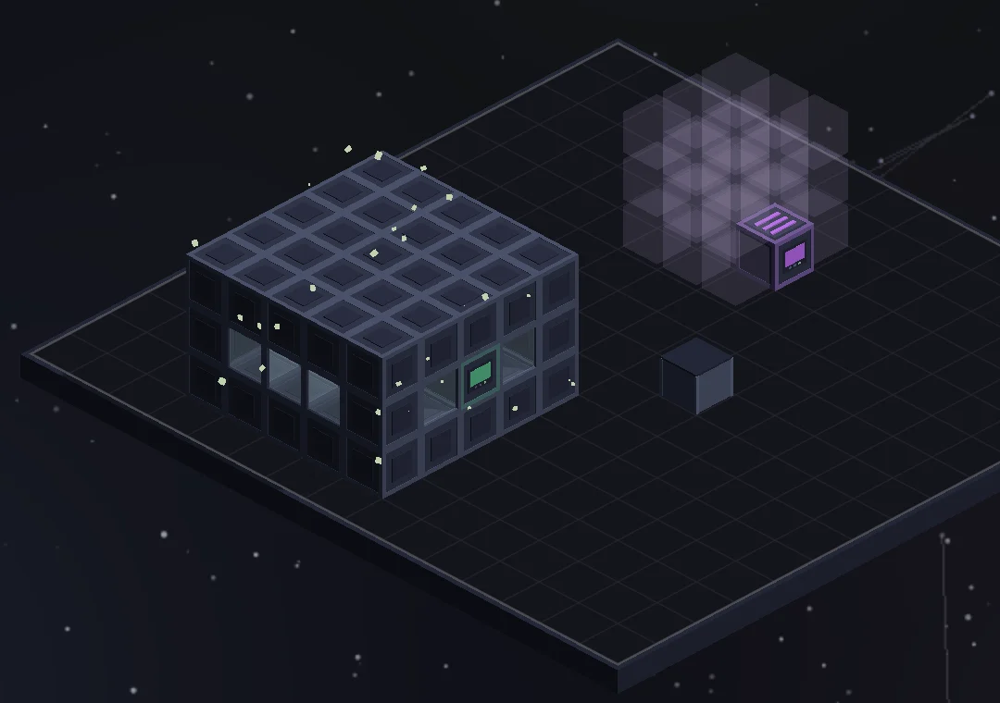

<p align="center">
  
</p>

<p align="center">
  <a href="https://github.com/Kureo524/CraftingSimulator/releases/latest"></a>
  
  
  
  
</p>

<p align="center">
  <a href="#jouer"><b>Jouer</b></a> ·
  <a href="Docs/MesRegles.md"><b>Mes règles de crafting</b></a> ·
  <a href="#contrôles"><b>Contrôles</b></a> ·
  <a href="#architecture"><b>Architecture</b></a>
</p>

<p align="center">
  
</p>

**Atelier Nucléaire** est une démo de crafting réalisée sous Unity pour la quête I4 de La Horde, « Mon atelier, mes règles ».
On n'y fabrique pas un objet d'un clic : on construit une **chaîne de procédés** inspirée de vrais procédés industriels
(broyage, fonte, électrolyse, chimie du soufre, enrichissement, fission). Chaque objet demande de choisir **quelles
machines** poser, **comment les relier** et **à quel régime** les faire tourner, jusqu'au Graal de l'atelier :
une pastille d'**antimatière**.

## Jouer

| Plateforme | Téléchargement | Lancer |
|---|---|---|
| Windows 64 bits | [`AtelierNucleaire-Windows.zip`](https://github.com/Kureo524/CraftingSimulator/releases/latest) | `AtelierNucleaire.exe` |
| Linux 64 bits | [`AtelierNucleaire-Linux.zip`](https://github.com/Kureo524/CraftingSimulator/releases/latest) | `AtelierNucleaire.x86_64` |

1. Télécharger l'archive de la [dernière release](https://github.com/Kureo524/CraftingSimulator/releases/latest) et la décompresser.
2. Lancer l'exécutable : le jeu s'ouvre **directement dans l'atelier**.
3. Un tutoriel guidé d'environ 5 minutes présente les bases. **« Passer le tutoriel »** débloque tout immédiatement.

> Une seule scène, pas de menu ni de sauvegarde : on arrive dans l'atelier et on fabrique.

## Les règles

<p align="center">
  
</p>

Chaque règle a une intention de gameplay, détaillée dans **[Mes règles de crafting](Docs/MesRegles.md)**.
Aucune ne s'applique sans un message qui la nomme : la machine affiche toujours son état et la cause de son blocage.

<p align="center">
  
</p>

## Les objectifs

<p align="center">
  
</p>

## Aperçu

<table>
  <tr>
    <td width="42%"></td>
    <td width="58%"></td>
  </tr>
  <tr>
    <td><sub><b>Pilotage du réacteur.</b> Combustion trop rapide pour l'eau disponible : l'alerte donne la cause et la vitesse d'échauffement.</sub></td>
    <td><sub><b>L'établi.</b> Les machines se fabriquent à partir de l'inventaire ; les ingrédients manquants sont signalés.</sub></td>
  </tr>
  <tr>
    <td colspan="2"></td>
  </tr>
  <tr>
    <td colspan="2"><sub><b>Multi-blocs.</b> Le réacteur à fission est complet (particules) ; le fantôme violet montre où construire le déphaseur.</sub></td>
  </tr>
</table>

## Contrôles

Les touches suivent la position physique (AZERTY entre parenthèses) et se changent dans les options (Échap).

| Action | Touche |
|---|---|
| Déplacer la caméra | <kbd>W</kbd><kbd>A</kbd><kbd>S</kbd><kbd>D</kbd> (<kbd>Z</kbd><kbd>Q</kbd><kbd>S</kbd><kbd>D</kbd>), ou clic molette maintenu |
| Zoom | Molette |
| Tourner la caméra | <kbd>R</kbd>, ou défilement horizontal du pavé tactile |
| Sélectionner / inspecter | Clic gauche sur un élément |
| Menu contextuel (démonter, déplacer…) | Clic droit sur un élément |
| Équiper un objet posable | <kbd>1</kbd> à <kbd>9</kbd>, puis clic gauche pour poser (glisser pour une ligne de câbles) |
| Tourner la machine à poser | <kbd>R</kbd> pendant la pose |
| Type du câble universel | <kbd>T</kbd> : électricité, liquide, gaz, objets |
| Ranger l'objet équipé / fermer | Clic droit ou <kbd>Échap</kbd> |
| Inventaire · Établi · Livre de recettes | <kbd>E</kbd> · <kbd>C</kbd> · <kbd>B</kbd> |
| Recette / usages de l'objet survolé | <kbd>R</kbd> / <kbd>U</kbd> |
| Mode normal → suppression → modification | <kbd>Q</kbd> (<kbd>A</kbd>) |
| Pause / reprise | <kbd>Espace</kbd> (vitesses ×1, ×2, ×4 en haut à droite) |

## Architecture

Le code est découpé en deux assemblies : **`Nucleaire.Core`**, la simulation pure sans rendu, testée en EditMode,
et **`Nucleaire.Game`**, la présentation 3D et l'interface UI Toolkit.

| Dossier | Contenu |
|---|---|
| `Assets/_Project/Data` | **Toutes les données** en ScriptableObjects : ressources, machines, procédés, recettes d'établi, améliorations, objectifs, tutoriel |
| `Assets/_Project/Scripts/Core` | `Data` (définitions et validateur), `Simulation` (monde, machines, réacteurs, multi-blocs), `Logistics` (réseaux de transmetteurs), `Crafting` (inventaire, actions du joueur, établi), `Objectives` |
| `Assets/_Project/Scripts/Game` | `Presentation` (vues 3D, caméra, pose), `UI` (panneaux UI Toolkit) |
| `Assets/_Project/Tests/EditMode` | 106 tests : procédés, réacteur, multi-blocs, logistique, inventaire, équilibrage, tutoriel |
| `Docs/` | Sujet, [page de règles](Docs/MesRegles.md), [direction artistique](Docs/DA/DA-Verre-d-encre.md), visuels |

**Données séparées du code.** Ajouter un procédé revient à créer un asset `ProcessRecipe` dans `Data/Recipes`, sans
toucher au code. La base de recettes se synchronise seule, et `RecipeDatabaseValidator` vérifie que chaque objectif
reste **atteignable** depuis les ressources de départ.

## Développement

- **Unity 6000.3.23f1** (Unity 6.3 LTS), URP, Input System, UI Toolkit.
- Cloner avec Git LFS : `git lfs install && git clone https://github.com/Kureo524/CraftingSimulator.git`
- Ouvrir le dossier dans Unity Hub, puis la scène `Assets/_Project/Scenes/Workshop.unity`.

```sh
# Tests EditMode
Unity -batchmode -projectPath . -runTests -testPlatform EditMode

# Builds de rendu → Build/Release/<plateforme>/
Unity -batchmode -quit -projectPath . -executeMethod Nucleaire.EditorTools.DevBuild.ReleaseWindows
Unity -batchmode -quit -projectPath . -executeMethod Nucleaire.EditorTools.DevBuild.ReleaseLinux

# Captures automatiques d'une build (scénarios de DemoScenarios.cs)
./AtelierNucleaire.x86_64 -autoshot <dossier> -autoshot-scenes multiblock,reactor-hot
```

Les visuels SVG de ce README sont générés par [`Docs/Images/gen_svg.py`](Docs/Images/gen_svg.py) dans la DA du jeu.

## Crédits

Conception et développement : **Kilian Monnier** · La Horde, Bachelor 3.
Direction artistique « Verre d'encre ». Polices sous licence OFL : Gothic A1, Barlow Condensed, IBM Plex Mono.
